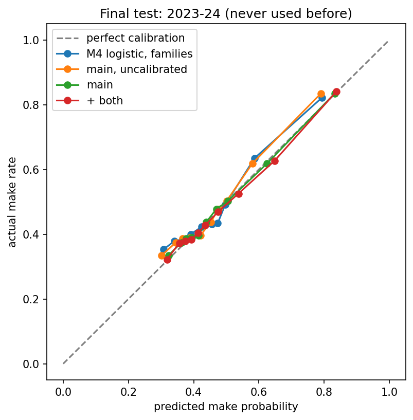
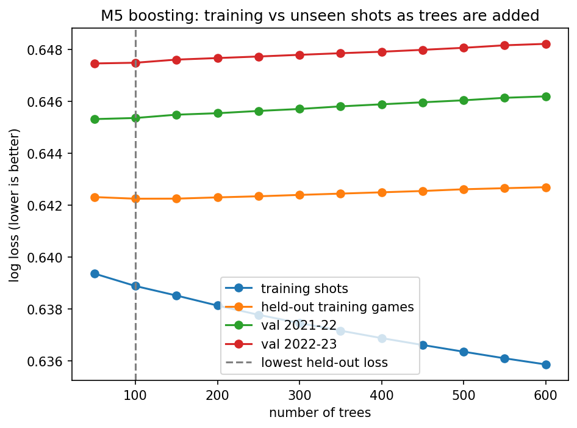
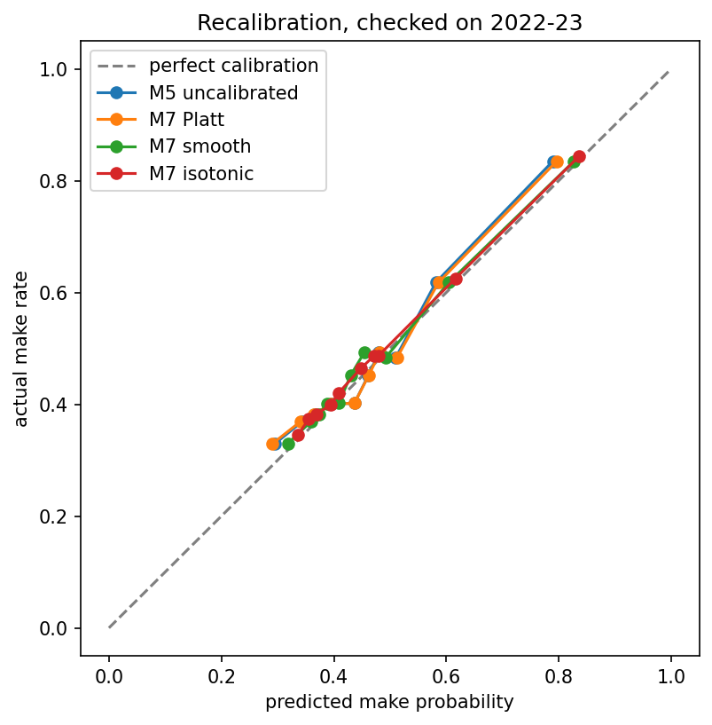

# Calibrated NBA Shot-Make Probabilities

A model that answers "what's the chance this NBA shot goes in?" --> and, more importantly, gives
probabilities you can **trust**: on a season it never saw (2023-24, 218k shots), its average prediction
was within **0.1 percentage points** of the real make rate.

Built from 4.2 million public regular-season shots (2003-04 to 2023-24), with leakage-safe, season-based
splits, a ladder of simple-to-complex models, game-level confidence intervals on every comparison, and a
test season opened exactly once.

**Status:** model and analysis complete. Interactive app (FastAPI + React) in progress.

---

## Headline results (test season 2023-24, never used before the final run)

| Model | Log loss ↓ | Brier ↓ | AUC ↑ | Avg predicted vs actual | Calibration error ↓ |
|---|---|---|---|---|---|
| Constant (league average) | 0.6926 | 0.2497 | 0.500 | 45.7% vs 47.5% | — |
| Distance shape + court zone (logistic) | 0.6584 | 0.2330 | 0.636 | 43.9% vs 47.5% | 0.037 |
| + shot type (logistic) | 0.6499 | 0.2301 | 0.636 | 46.4% vs 47.5% | 0.026 |
| Gradient boosting, uncalibrated | 0.6468 | 0.2286 | 0.645 | 46.2% vs 47.5% | 0.021 |
| **Gradient boosting + smooth calibration (main model)** | **0.6451** | **0.2279** | **0.645** | **47.4% vs 47.5%** | **0.007** |
| Main + shooter skill | 0.6425 | 0.2267 | 0.651 | 47.7% vs 47.5% | 0.009 |
| Main + opponent defense | 0.6450 | 0.2279 | 0.646 | 47.8% vs 47.5% | 0.010 |
| Main + both | 0.6422 | 0.2266 | 0.652 | 47.9% vs 47.5% | 0.009 |

Is each step real, or luck? Paired, game-level bootstrap (1,000 resamples of the 1,230 test games):

| Comparison (A vs B) | Log loss difference | 95% interval | Verdict |
|---|---|---|---|
| Calibrated vs uncalibrated main model | −0.0017 | [−0.0020, −0.0015] | calibration helps |
| Main model vs logistic regression | −0.0049 | [−0.0053, −0.0045] | boosting + calibration helps |
| + shot type vs distance + zone | −0.0084 | [−0.0092, −0.0076] | shot type helps |
| + shooter skill vs main | −0.0026 | [−0.0029, −0.0022] | **who shoots matters** |
| + opponent defense vs main | −0.0000 | [−0.0003, +0.0003] | **no clear difference** |
| + both vs + shooter skill | −0.0002 | [−0.0005, +0.0000] | no clear difference |



**Why the log-loss numbers look small:** from public data, most of a shot's outcome is genuinely
unpredictable (a wide-open 45% jumper is close to a coin flip). A constant guess scores 0.693 and the best
model 0.642; every gain above is small but clears its confidence interval.

---

## Questions this project answers

1. **What information matters beyond shot distance?** Shot type (layup, floater, step-back…) matters most;
   angle, game clock and home/away add very little once distance and court zone are known.
2. **Are the probabilities calibrated, and do they stay calibrated in later seasons?** Not automatically:
   make rates keep rising, so a model trained on the past under-predicts the future by ~1 point. Retraining
   on the most recent seasons and recalibrating on the season just before fixes it (47.4% predicted vs
   47.5% actual on the test season).
3. **Does shooter identity help, without leaking the future?** Yes. An "as-of" shooter skill (built only
   from games *before* each shot, shrunk toward average for small samples) improves the model on the test
   season, most for players with long histories.
4. **Does team defense help?** It looked like it on validation, but not on the test season once the models
   were calibrated (see findings).

---

## Data

- **Source:** "NBA Shots" (NBA.com data compiled by DomSamangy, mirrored on Kaggle), 21 regular seasons,
  4,231,262 shots. Not redistributed here; see [DATA_CARD.md](DATA_CARD.md) for terms, checksum and download steps.
- **Cleaning** ([`clean_data.py`](nba_shots/clean_data.py), checked by [`check_data.py`](nba_shots/check_data.py)):
  - three seasons (2019-20 to 2021-22) stored court coordinates at 1/10 scale with a shifted origin;
    found by checking x/y against the distance column, and fixed
  - five 2020-21 games share a placeholder game ID; every game gets a unique key
  - 192 exact duplicate rows and 8,820 backcourt heaves removed (this models normal shot attempts)
- **No defender positions or shot clock** exist in multi-season public data (see limitations).

## Method

**Splits by whole season** (a game is never in two splits; training always comes before testing):

| Split | Seasons | Shots | Used for |
|---|---|---|---|
| Train | 2012-13 to 2018-19 (2003-04 on for comparison) | 1.46M | fitting |
| Covid (set aside) | 2019-20, 2020-21 | 378k | never trained or scored on; crowd analysis only |
| Validation | 2021-22, 2022-23 | 433k | every model choice |
| Test | 2023-24 | 218k | opened once, at the end |

**Model ladder.** Each model had to beat the one before it on validation:

| Model | Validation log loss |
|---|---|
| M0 constant | 0.6916 |
| M1 logistic, distance only | 0.6654 |
| M2 + distance bends ("hinges") + three-point flag + court zone | 0.6571 |
| M3 court-square lookup table (smoothed) | 0.6592 — *worse than M2* |
| M4 logistic, all features + shot family | 0.6486 |
| M5 gradient boosting (scikit-learn `HistGradientBoostingClassifier`) | 0.6464 |
| M5 + shooter skill / + opponent defense / + both | 0.6433 / 0.6448 / 0.6424 |

**Key design choices** (all decided on validation, before the test season was opened):

- **Shot families, not raw shot labels.** The NBA's shot descriptions changed meaning over time
  ("Layup Shot" fell from 15% to 3% of shots as new specific labels appeared). Grouping about 70 labels into 9
  families keeps their meaning stable across seasons and gives the app a usable dropdown.
- **Train on 2012-13 onward.** Every model did better on recent seasons than with all seasons from 2003-04
  (e.g. +0.0042 log loss for M4 when older seasons were included, interval [+0.0039, +0.0044]).
- **Boosting stopped by the newest training season**, with cautious trees (≥1,000 shots per leaf, an L2
  penalty) and no raw court coordinates. Tuning showed raw coordinates helped within the training era but
  not on later seasons.
- **Smooth recalibration** (logistic regression on the log-odds plus 4 "hinge" bends; 6 numbers in total),
  learned on the season before the one being predicted.
- **As-of skill features**: makes above a league-average shot of the same family and zone, summed over a
  player's (or defense's) *earlier games only*, divided by (shots + 1,000). Tests prove a shot's own outcome
  and later games can never affect its value.

## What I found along the way

- **Shot labels drift.** Within layups, the word "Driving" went from 30% to 53% of labels (2012-13 to
  2022-23) and its effect flipped: from +17 points (easier layups) to −10 points. A model that trusts the
  label learns the scorekeepers' habits, not basketball. Labels tagged "Bank" go in far more often than their
  non-bank versions, likely because the tag is mostly applied when the shot banks in.
- **Overfitting to an era, not just to data.** Early boosting versions kept improving on held-out games from
  the training seasons while getting slightly *worse* on later seasons. Stopping on the newest training season
  and removing raw coordinates fixed it: boosting's edge over logistic regression is now the same on shots it
  trained on (0.0026), unseen training-era games (0.0018) and both later seasons (0.0023 each).
  
- **Isotonic recalibration overfit; a smooth curve didn't.** Isotonic scored slightly better on one season,
  but learned from 10% of the data its gain fell from +0.0019 to −0.0014, and it had a "step" holding a single
  shot. The 6-number smooth curve kept almost all of its gain (+0.0016 → +0.0014).
  
- **A feature can look useful because it fixes a different problem.** Opponent defense helped on
  validation (−0.0016, interval [−0.0018, −0.0014]) but not on the test season. Likely reason: validation
  compared uncalibrated models that all predicted too low, and the defense feature partly sensed "this season
  is shooting hotter". Once calibration fixed the level, its value disappeared.
- **Calibrated overall ≠ calibrated everywhere.** On the test season the main model is off by up to
  ±5 points within shot families (layups 4.5 points too low, pull-ups 5.6 too high), errors that cancel out
  overall. Shooter skill fixes most of the layup gap (who is finishing at the rim matters).

## Limitations

- **No defender distance, shot clock or tracking data.** The only public shot-level defender data covers
  part of 2014-15, too narrow to validate on recent seasons. Team-level defense is a weak substitute.
- **Shot type is recorded after the shot** by scorekeepers; the model reports results with and without it.
- **One test season.** 2023-24 is a single season; drift means performance on 2024-25 will need re-checking.
- **Within-family calibration** (above) is not fixed; doing it properly needs a new, untouched test season.

## Future work

- Per-family recalibration, judged on 2024-25
- Player tracking data (defender distance at release, closing speed), where available
- Season-level drift monitoring: refit the calibrator each season

## Reproduce

Needs Python 3.10 to 3.13 (the pinned packages don't have ready-made builds for 3.14 yet).

```bash
python3 -m venv .venv
source .venv/bin/activate
pip install -r requirements.txt

# put the dataset zip at data/nba_data.zip (see data/README.md), then:
python -m nba_shots.clean_data        # clean the 21 season files
python -m nba_shots.check_data        # sanity checks (stops on serious problems)
python -m nba_shots.train_baselines   # M0-M4, about 1 minute
python -m nba_shots.tune_boosting     # compares boosting setups, ~10 minutes
python -m nba_shots.train_boosting    # M5, several minutes
python -m nba_shots.calibrate         # M7 recalibration + its overfitting checks
python -m nba_shots.compare_models    # game-level confidence intervals
python -m nba_shots.check_overfitting # training vs unseen shots, several minutes
python -m nba_shots.train_skill       # + shooter skill / + opponent defense / + both, ~20 minutes
python -m nba_shots.final_test        # the ONE-TIME test on 2023-24, ~15 minutes
python -m pytest                      # 53 tests on made-up data (no dataset needed)
```

Results land in `results/`; every number in this README comes from those files.

## Repository layout

```
nba_shots/
  config.py            every setting and decision, with the date and reason it changed
  clean_data.py        raw CSVs -> cleaned per-season files
  check_data.py        data sanity checks
  splits.py            season-based splits and their integrity checks
  leakage.py           columns that can never be model inputs
  features.py          feature building, including the as-of shooter / defense skill
  models.py            the model ladder (every model is predict_xxx(train, val))
  evaluate.py          scores, calibration measures, game-level bootstrap
  calibrate.py         Platt / smooth / isotonic recalibration and their overfitting checks
  train_*.py, tune_boosting.py, compare_models.py, check_overfitting.py, final_test.py   runnable steps
tests/                 unit tests, including leakage and split checks (run on GitHub on every push)
results/               output tables and figures
```

Developed with Claude (an AI assistant) as a pair programmer.
